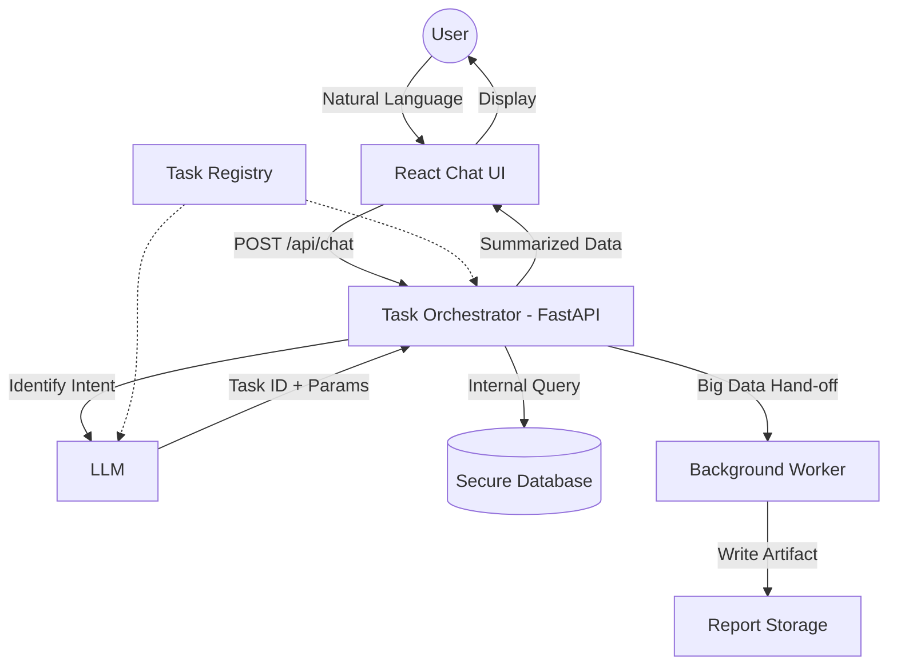

# Task-Oriented Protected Data (TOPD) Bridge

## Architecture Overview

## Security & Design Principles

1.  **Zero-SQL LLM**: The LLM does not know SQL exists. It only knows it can call "Tools" or "Tasks".
2.  **Schema Blindness**: The LLM never sees table names, column types, or relationships. It only sees "Display Labels" and "Parameter Descriptions".
3.  **Immutable Queries**: SQL is hard-coded in the backend. Parameters are bound, never concatenated.
4.  **The 1000-Row Wall**: Any query resulting in > 1000 rows is automatically truncated for the LLM or pushed to an async report.
5.  **Auditability**: Every task execution is logged with metadata, but never raw PII data.

## Folder Structure

- `backend/`: FastAPI application
    - `api/`: Route definitions
    - `core/`: Config, Security, Registry
    - `services/`: Business logic and Data Access
    - `tasks/`: Background job definitions
- `shared/`: Task Registry JSON and Schemas
- `scripts/`: Initialization and helper scripts
- `.env`: Environment variables (credentials)
